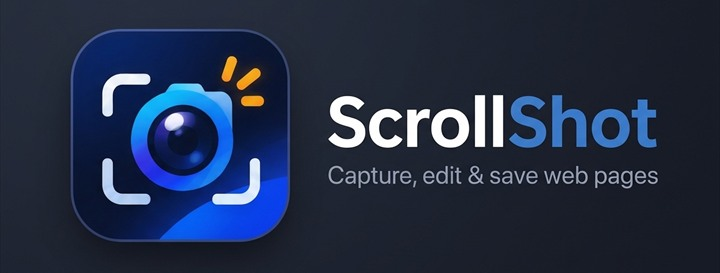
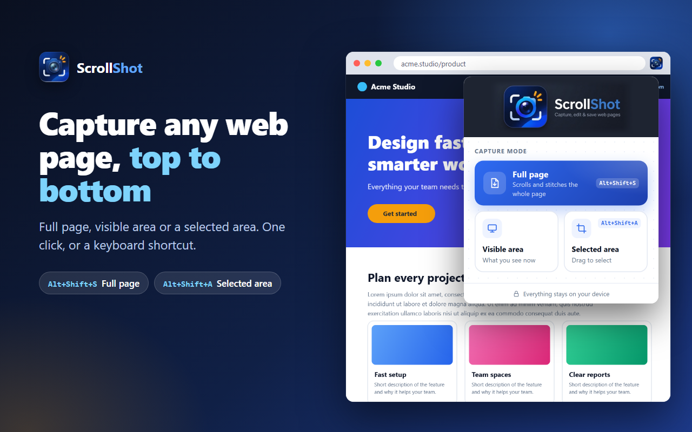
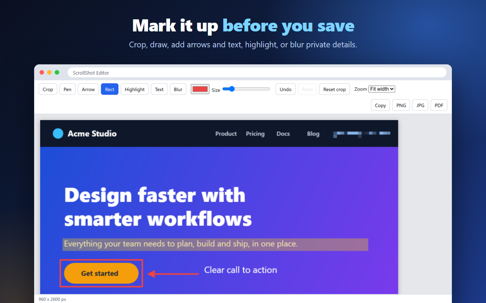

**Capture a whole web page in one click, mark it up, and save it as PNG, JPG or PDF.**

[Chrome Web Store](https://chromewebstore.google.com/detail/scrollshot/fbbkdekmndboaemgjfhlbnhngbbjngjg) · [Website](https://sheikhfahad67.github.io/ScrollShot-Preview/) · [Privacy policy](https://sheikhfahad67.github.io/ScrollShot-Preview/privacy-policy.html) · [Support](https://github.com/sheikhfahad67/ScrollShot-Preview/issues)

---

This repository is the **public home of ScrollShot**: the website, the privacy policy, and the support page. ScrollShot is a Chrome extension. **[Add it to Chrome from the Chrome Web Store](https://chromewebstore.google.com/detail/scrollshot/fbbkdekmndboaemgjfhlbnhngbbjngjg)**.

## What it does

- **Capture:** full page (it scrolls for you), visible area, or a selected area you drag.
- **Edit:** crop, pen, arrow, rectangle, highlight, text and blur, with undo and redo.
- **Save:** PNG, JPG or multi-page A4 PDF, or copy to the clipboard.
- **Private:** everything happens on your computer. No data is collected or sent anywhere.

## Support

Found a problem or have an idea? [Open an issue](https://github.com/sheikhfahad67/ScrollShot-Preview/issues). If you can, include the website address and what you expected to see.

## What is in this repository

| Path | Contents |
|---|---|
| `index.html` | The landing page |
| `privacy-policy.html` | The privacy policy |
| `assets/` | Logo, icons, screenshots and the page stylesheet |

The extension's source code is not published here.
